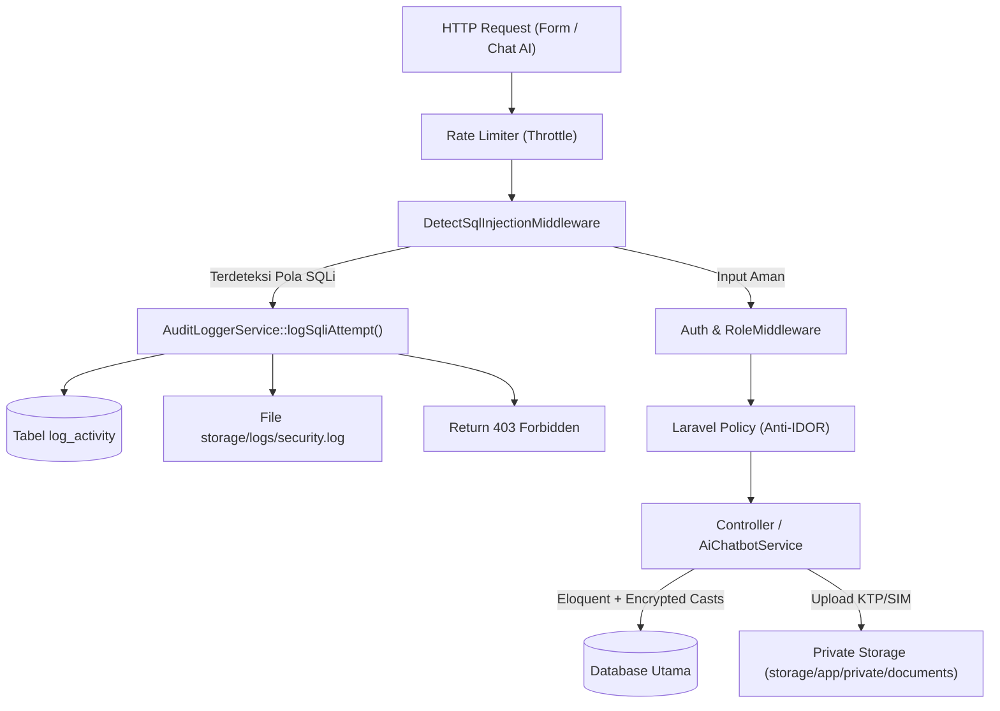

# Rencana Implementasi Sistem Keamanan, Anti-SQLi/Prompt Injection, & Hybrid Audit Log (Mazseh)

## Goal Description

Dokumen ini adalah panduan implementasi teknis bertahap (*step-by-step*) untuk membangun fondasi keamanan pada aplikasi penyewaan mobil **Mazseh** (Laravel 13 / PHP 8.5). Panduan ini ditulis secara eksplisit dengan potongan kode lengkap di setiap tahapannya agar dapat langsung dieksekusi oleh **Junior Programmer** maupun **AI Model yang lebih murah/ringan** tanpa kebingungan atau kesalahan asumsi.

Lingkup keamanan yang akan diimplementasikan meliputi:
1. **Proteksi Data Pelanggan (PII & Dokumen KTP/SIM):** Penyimpanan di *Private Storage*, penamaan UUID, enkripsi data sensitif di database (*Encrypted Casts*), pencegahan *Mass Assignment*, pencegahan *IDOR* dengan Laravel Policy, dan pengamanan histori transaksi dengan *Soft Deletes*.
2. **Antisipasi SQL Injection & Prompt Injection (Form & AI Chatbot):** Penggunaan penuh *PDO Prepared Statements* via Eloquent, *WAF Middleware* pendeteksi pola `SQLI_ATTEMPT`, *Rate Limiting*, serta isolasi *Read-Only Tool Calling* pada AI Chatbot.
3. **Hybrid Audit Logging (`log_activity` + `security.log`):** Pencatatan audit trail yang *Immutable* (tidak bisa diubah/dihapus dari aplikasi) ke tabel `log_activity` untuk Dashboard Admin, dikombinasikan dengan file log harian `storage/logs/security.log` agar bukti serangan tetap aman meskipun terjadi *database rollback* atau gangguan DB.

---

## Arsitektur Alur Keamanan



---

## User Review Required

> [!IMPORTANT]
> **Keputusan Arsitektur yang Perlu Anda Setujui Sebelum Eksekusi:**
> 1. **Enkripsi Kolom Koordinat (`latitude`, `longitude`, `titik_jemput`):** Pada rencana ini, kolom lokasi jemput di tabel `transaksi` dienkripsi di level aplikasi menggunakan cast `'encrypted'`. Konsekuensinya, kolom tersebut sangat aman jika database bocor, namun tidak bisa dihitung jaraknya menggunakan rumus SQL `ST_Distance` langsung di database (perhitungan jarak dilakukan di PHP).
> 2. **Perubahan Foreign Key `cascade` menjadi `restrict` + `SoftDeletes`:** Akan dibuat 1 file migration baru untuk menambahkan `deleted_at` (`softDeletes`) pada tabel `users` dan `transaksi` agar histori keuangan di tabel `pembayaran` tidak ikut terhapus permanen jika akun user dihapus.
> 3. **Blokir Otomatis Request SQLi (`403 Forbidden`):** Jika `DetectSqlInjectionMiddleware` mendeteksi payload serangan SQL Injection pada form atau chat, sistem akan langsung mencatatnya ke `log_activity` + `security.log` dan menghentikan request dengan status `403`.

---

## Proposed Changes (Urutan Tahapan Implementasi)

> [!TIP]
> **Instruksi untuk Junior Programmer / AI Implementor:**
> Kerjakan tahapan di bawah ini **secara berurutan dari Tahap 1 sampai Tahap 8**. Jangan melompati tahapan karena setiap tahap bergantung pada file yang dibuat di tahap sebelumnya. Patuhi standar PHP 8.5 (gunakan *explicit return type*, *constructor property promotion*, dan kurung kurawal `{}` di setiap blok `if`).

---

### Tahap 1: Pengamanan Integritas Database (Soft Deletes & Foreign Key)

Saat ini pada [2026_10_28_035424_create_transaksi_table.php](file:///D:/laragon/www/mazseh/database/migrations/2026_10_28_035424_create_transaksi_table.php) dan [2026_10_28_033945_create_document_pelanggan_table.php](file:///D:/laragon/www/mazseh/database/migrations/2026_10_28_033945_create_document_pelanggan_table.php), panjang kolom path file dan teks lokasi perlu menampung hasil enkripsi Laravel (string hasil enkripsi lebih panjang dari teks biasa), serta tabel `users` dan `transaksi` memerlukan `softDeletes()`.

#### [NEW] `database/migrations/2026_10_28_050000_harden_security_and_soft_deletes_tables.php`
Buat migration baru untuk:
1. Menambahkan `softDeletes()` (`deleted_at`) pada tabel `users`, `transaksi`, dan `document_pelanggan`.
2. Mengubah tipe kolom `file_ktp` dan `file_sim` pada `document_pelanggan` menjadi `text` serta `latitude` dan `longitude` pada `transaksi` menjadi `text` (karena ciphertext hasil enkripsi `Crypt::encryptString()` membutuhkan panjang lebih dari 255 karakter).

```php
<?php

use Illuminate\Database\Migrations\Migration;
use Illuminate\Database\Schema\Blueprint;
use Illuminate\Support\Facades\Schema;

return new class extends Migration
{
    public function up(): void
    {
        Schema::table('users', function (Blueprint $table): void {
            $table->softDeletes();
        });

        Schema::table('document_pelanggan', function (Blueprint $table): void {
            $table->text('file_ktp')->change();
            $table->text('file_sim')->change();
            $table->softDeletes();
        });

        Schema::table('transaksi', function (Blueprint $table): void {
            $table->text('latitude')->nullable()->change();
            $table->text('longitude')->nullable()->change();
            $table->softDeletes();
        });
    }

    public function down(): void
    {
        Schema::table('transaksi', function (Blueprint $table): void {
            $table->string('latitude', 50)->nullable()->change();
            $table->string('longitude', 50)->nullable()->change();
            $table->dropSoftDeletes();
        });

        Schema::table('document_pelanggan', function (Blueprint $table): void {
            $table->string('file_ktp', 255)->change();
            $table->string('file_sim', 255)->change();
            $table->dropSoftDeletes();
        });

        Schema::table('users', function (Blueprint $table): void {
            $table->dropSoftDeletes();
        });
    }
};
```

---

### Tahap 2: Konfigurasi Private Storage & Security Log Channel

#### [MODIFY] [filesystems.php](file:///D:/laragon/www/mazseh/config/filesystems.php)
Tambahkan disk khusus bernama `documents` yang mengarah ke `storage_path('app/private/documents')` dengan `'visibility' => 'private'` di dalam array `'disks'`:

```php
        'documents' => [
            'driver' => 'local',
            'root' => storage_path('app/private/documents'),
            'visibility' => 'private',
            'throw' => true,
            'report' => false,
        ],
```

#### [MODIFY] [logging.php](file:///D:/laragon/www/mazseh/config/logging.php)
Tambahkan channel `security` dengan driver `daily` dan masa simpan 90 hari di dalam array `'channels'`:

```php
        'security' => [
            'driver' => 'daily',
            'path' => storage_path('logs/security.log'),
            'level' => 'info',
            'days' => 90,
            'replace_placeholders' => true,
        ],
```

---

### Tahap 3: Pembuatan PHP Enums & Eloquent Models yang Aman

Gunakan PHP 8.5 Backed Enums dengan penamaan **TitleCase** sesuai standar project di [AGENTS.md](file:///D:/laragon/www/mazseh/AGENTS.md).

#### [NEW] `app/Enums/UserRole.php`
```php
<?php

namespace App\Enums;

enum UserRole: string
{
    case Admin = 'admin';
    case Kasir = 'kasir';
    case Pelanggan = 'pelanggan';
}
```

#### [NEW] `app/Enums/JenisAksiLog.php`
```php
<?php

namespace App\Enums;

enum JenisAksiLog: string
{
    case Insert = 'INSERT';
    case Update = 'UPDATE';
    case Delete = 'DELETE';
    case LoginFailed = 'LOGIN_FAILED';
    case SqliAttempt = 'SQLI_ATTEMPT';
}
```

#### [MODIFY] [User.php](file:///D:/laragon/www/mazseh/app/Models/User.php)
* Tambahkan trait `SoftDeletes`.
* **JANGAN** masukkan `role` ke dalam `#[Fillable]` agar terhindar dari *Mass Assignment* privilege escalation.
* Tambahkan cast `'role' => UserRole::class` dan method helper pengecekan role.

```php
<?php

namespace App\Models;

use App\Enums\UserRole;
use Database\Factories\UserFactory;
use Illuminate\Database\Eloquent\Attributes\Fillable;
use Illuminate\Database\Eloquent\Attributes\Hidden;
use Illuminate\Database\Eloquent\Factories\HasFactory;
use Illuminate\Database\Eloquent\Relations\HasMany;
use Illuminate\Database\Eloquent\Relations\HasOne;
use Illuminate\Database\Eloquent\SoftDeletes;
use Illuminate\Foundation\Auth\User as Authenticatable;
use Illuminate\Notifications\Notifiable;

#[Fillable(['name', 'email', 'password'])]
#[Hidden(['password', 'remember_token'])]
class User extends Authenticatable
{
    /** @use HasFactory<UserFactory> */
    use HasFactory, Notifiable, SoftDeletes;

    /**
     * @return array<string, string>
     */
    protected function casts(): array
    {
        return [
            'email_verified_at' => 'datetime',
            'password' => 'hashed',
            'role' => UserRole::class,
        ];
    }

    public function isAdmin(): bool
    {
        return $this->role === UserRole::Admin;
    }

    public function isKasir(): bool
    {
        return $this->role === UserRole::Kasir;
    }

    public function isPelanggan(): bool
    {
        return $this->role === UserRole::Pelanggan;
    }

    public function documentPelanggan(): HasOne
    {
        return $this->hasOne(DocumentPelanggan::class, 'user_id');
    }

    public function transaksi(): HasMany
    {
        return $this->hasMany(Transaksi::class, 'user_id');
    }
}
```

#### [NEW] `app/Models/DocumentPelanggan.php`
Enkripsi kolom `file_ktp` dan `file_sim` secara otomatis menggunakan cast `'encrypted'`.

```php
<?php

namespace App\Models;

use Illuminate\Database\Eloquent\Attributes\Fillable;
use Illuminate\Database\Eloquent\Model;
use Illuminate\Database\Eloquent\Relations\BelongsTo;
use Illuminate\Database\Eloquent\SoftDeletes;

#[Fillable(['user_id', 'file_ktp', 'file_sim', 'status_verifikasi'])]
class DocumentPelanggan extends Model
{
    use SoftDeletes;

    protected $table = 'document_pelanggan';

    protected $primaryKey = 'id_dokumen';

    /**
     * @return array<string, string>
     */
    protected function casts(): array
    {
        return [
            'file_ktp' => 'encrypted',
            'file_sim' => 'encrypted',
        ];
    }

    public function user(): BelongsTo
    {
        return $this->belongsTo(User::class, 'user_id');
    }
}
```

#### [NEW] `app/Models/Transaksi.php`
Enkripsi koordinat (`latitude`, `longitude`, `titik_jemput`) menggunakan cast `'encrypted'`.

```php
<?php

namespace App\Models;

use Illuminate\Database\Eloquent\Attributes\Fillable;
use Illuminate\Database\Eloquent\Model;
use Illuminate\Database\Eloquent\Relations\BelongsTo;
use Illuminate\Database\Eloquent\SoftDeletes;

#[Fillable([
    'user_id',
    'id_mobil',
    'tanggal_mulai',
    'tanggal_selesai',
    'total_harga',
    'status_pesanan',
    'alasan_batal',
    'latitude',
    'longitude',
    'titik_jemput',
])]
class Transaksi extends Model
{
    use SoftDeletes;

    public $timestamps = false;

    protected $table = 'transaksi';

    protected $primaryKey = 'id_transaksi';

    /**
     * @return array<string, string>
     */
    protected function casts(): array
    {
        return [
            'tanggal_mulai' => 'date',
            'tanggal_selesai' => 'date',
            'total_harga' => 'decimal:2',
            'latitude' => 'encrypted',
            'longitude' => 'encrypted',
            'titik_jemput' => 'encrypted',
            'waktu_pesan' => 'datetime',
        ];
    }

    public function user(): BelongsTo
    {
        return $this->belongsTo(User::class, 'user_id');
    }

    public function mobil(): BelongsTo
    {
        return $this->belongsTo(KatalogMobil::class, 'id_mobil', 'id_mobil');
    }
}
```

#### [NEW] `app/Models/KatalogMobil.php`
```php
<?php

namespace App\Models;

use Illuminate\Database\Eloquent\Attributes\Fillable;
use Illuminate\Database\Eloquent\Model;

#[Fillable([
    'id_kategori',
    'plat_nomor',
    'merk_model',
    'harga_sewa',
    'status_ketersediaan',
    'versi',
])]
class KatalogMobil extends Model
{
    protected $table = 'katalog_mobil';

    protected $primaryKey = 'id_mobil';

    /**
     * @return array<string, string>
     */
    protected function casts(): array
    {
        return [
            'harga_sewa' => 'decimal:2',
            'versi' => 'integer',
        ];
    }
}
```

#### [NEW] `app/Models/SesiChatAi.php`
```php
<?php

namespace App\Models;

use Illuminate\Database\Eloquent\Attributes\Fillable;
use Illuminate\Database\Eloquent\Model;
use Illuminate\Database\Eloquent\Relations\BelongsTo;

#[Fillable([
    'user_id',
    'pesan_pelanggan',
    'balasan_ai',
    'status_sesi',
])]
class SesiChatAi extends Model
{
    public $timestamps = false;

    protected $table = 'sesi_chat_ai';

    protected $primaryKey = 'id_sesi';

    /**
     * @return array<string, string>
     */
    protected function casts(): array
    {
        return [
            'waktu_sesi' => 'datetime',
        ];
    }

    public function user(): BelongsTo
    {
        return $this->belongsTo(User::class, 'user_id');
    }
}
```

#### [NEW] `app/Models/LogActivity.php`
Model ini dirancang **Immutable (Append-Only)**: setiap percobaan `update()` atau `delete()` pada model `LogActivity` akan melempar `LogicException`.

```php
<?php

namespace App\Models;

use App\Enums\JenisAksiLog;
use Illuminate\Database\Eloquent\Attributes\Fillable;
use Illuminate\Database\Eloquent\Model;
use Illuminate\Database\Eloquent\Relations\BelongsTo;
use LogicException;

#[Fillable([
    'user_id',
    'tabel_terdampak',
    'jenis_aksi',
    'keterangan',
    'ip_address',
    'waktu_kejadian',
])]
class LogActivity extends Model
{
    public $timestamps = false;

    protected $table = 'log_activity';

    protected $primaryKey = 'id_log';

    protected static function booted(): void
    {
        static::updating(function (): never {
            throw new LogicException('Audit log bersifat immutable dan tidak dapat diubah.');
        });

        static::deleting(function (): never {
            throw new LogicException('Audit log bersifat immutable dan tidak dapat dihapus.');
        });
    }

    /**
     * @return array<string, string>
     */
    protected function casts(): array
    {
        return [
            'jenis_aksi' => JenisAksiLog::class,
            'waktu_kejadian' => 'datetime',
        ];
    }

    public function user(): BelongsTo
    {
        return $this->belongsTo(User::class, 'user_id');
    }
}
```

---

### Tahap 4: Layanan Hybrid Audit Logger & Model Observer

#### [NEW] `app/Services/AuditLoggerService.php`
Service ini menangani pencatatan **Hybrid**:
1. Menyimpan ke tabel `log_activity` untuk ditampilkan di Dashboard Admin.
2. Menyimpan ke file `storage/logs/security.log` (channel `security`) untuk aksi keamanan kritis (`SQLI_ATTEMPT`, `LOGIN_FAILED`, `DELETE`) atau sebagai *fallback* jika database sedang bermasalah.

```php
<?php

namespace App\Services;

use App\Enums\JenisAksiLog;
use App\Models\LogActivity;
use Illuminate\Http\Request;
use Illuminate\Support\Facades\Auth;
use Illuminate\Support\Facades\Log;
use Throwable;

class AuditLoggerService
{
    public function record(
        string $tabelTerdampak,
        JenisAksiLog $jenisAksi,
        string $keterangan,
        ?int $userId = null,
        ?string $ipAddress = null,
    ): void {
        $resolvedUserId = $userId ?? Auth::id();
        $resolvedIp = $ipAddress ?? request()?->ip();

        $context = [
            'user_id' => $resolvedUserId,
            'tabel_terdampak' => $tabelTerdampak,
            'jenis_aksi' => $jenisAksi->value,
            'keterangan' => $keterangan,
            'ip_address' => $resolvedIp,
            'timestamp' => now()->toIso8601String(),
        ];

        // 1. Selalu catat ke file security.log untuk aksi keamanan kritis
        if (in_array($jenisAksi, [JenisAksiLog::SqliAttempt, JenisAksiLog::LoginFailed, JenisAksiLog::Delete], true)) {
            Log::channel('security')->warning("Security Audit [{$jenisAksi->value}] on {$tabelTerdampak}", $context);
        }

        // 2. Catat ke tabel log_activity untuk Dashboard Admin
        try {
            LogActivity::query()->create([
                'user_id' => $resolvedUserId,
                'tabel_terdampak' => substr($tabelTerdampak, 0, 50),
                'jenis_aksi' => $jenisAksi,
                'keterangan' => $keterangan,
                'ip_address' => $resolvedIp,
                'waktu_kejadian' => now(),
            ]);
        } catch (Throwable $exception) {
            Log::channel('security')->error('Gagal menyimpan log_activity ke database', [
                ...$context,
                'error' => $exception->getMessage(),
            ]);
        }
    }

    public function logSqliAttempt(Request $request, string $fieldName, string $suspiciousValue): void
    {
        $snippet = mb_substr($suspiciousValue, 0, 200);
        $target = $request->is('*/chat*') ? 'sesi_chat_ai' : ($request->route()?->getName() ?? $request->path());

        $this->record(
            tabelTerdampak: (string) $target,
            jenisAksi: JenisAksiLog::SqliAttempt,
            keterangan: "Indikasi SQL Injection pada input [{$fieldName}]: {$snippet}",
            userId: Auth::id(),
            ipAddress: $request->ip(),
        );
    }

    public function logLoginFailed(string $email, ?string $ipAddress = null): void
    {
        $this->record(
            tabelTerdampak: 'users',
            jenisAksi: JenisAksiLog::LoginFailed,
            keterangan: "Percobaan login gagal untuk email: {$email}",
            userId: null,
            ipAddress: $ipAddress,
        );
    }
}
```

#### [NEW] `app/Observers/AuditModelObserver.php`
Observer otomatis yang mendengarkan event `created`, `updated`, dan `deleted` pada model bisnis penting (`DocumentPelanggan`, `Transaksi`, `KatalogMobil`).

```php
<?php

namespace App\Observers;

use App\Enums\JenisAksiLog;
use App\Services\AuditLoggerService;
use Illuminate\Database\Eloquent\Model;

class AuditModelObserver
{
    public function __construct(public AuditLoggerService $auditLogger) {}

    public function created(Model $model): void
    {
        $this->auditLogger->record(
            tabelTerdampak: $model->getTable(),
            jenisAksi: JenisAksiLog::Insert,
            keterangan: sprintf('Data baru dibuat pada %s dengan ID %s', $model->getTable(), (string) $model->getKey()),
        );
    }

    public function updated(Model $model): void
    {
        $changedColumns = implode(', ', array_keys($model->getChanges()));

        $this->auditLogger->record(
            tabelTerdampak: $model->getTable(),
            jenisAksi: JenisAksiLog::Update,
            keterangan: sprintf('Data ID %s diperbarui pada kolom: %s', (string) $model->getKey(), $changedColumns),
        );
    }

    public function deleted(Model $model): void
    {
        $this->auditLogger->record(
            tabelTerdampak: $model->getTable(),
            jenisAksi: JenisAksiLog::Delete,
            keterangan: sprintf('Data ID %s dihapus dari %s', (string) $model->getKey(), $model->getTable()),
        );
    }
}
```

---

### Tahap 5: Middleware Pertahanan (WAF Pendeteksi SQLi & Role Access Control)

#### [NEW] `app/Http/Middleware/DetectSqlInjectionMiddleware.php`
Middleware ini memeriksa seluruh parameter input (`query`, `post`, maupun payload JSON/chat) terhadap pola-pola serangan SQL Injection. Jika ditemukan, ia memanggil `AuditLoggerService::logSqliAttempt()` dan mengembalikan HTTP `403 Forbidden`.

```php
<?php

namespace App\Http\Middleware;

use App\Services\AuditLoggerService;
use Closure;
use Illuminate\Http\Request;
use Symfony\Component\HttpFoundation\Response;

class DetectSqlInjectionMiddleware
{
    /**
     * Daftar regex pola umum SQL Injection.
     *
     * @var list<string>
     */
    private const array SQLI_PATTERNS = [
        '/\bUNION\b\s+(?:\bALL\b\s+)?\bSELECT\b/i',
        '/(?:\'|"|\b)\s*(?:OR|AND)\s+(?:\'?"?\d+\'?"?\s*=\s*\'?"?\d+\'?"?|\'[^\']+\'\s*=\s*\'[^\']+\')/i',
        '/;\s*\b(?:DROP|DELETE|TRUNCATE|ALTER|UPDATE|INSERT)\b\s+\b(?:TABLE|FROM|INTO|DATABASE)\b/i',
        '/\b(?:SLEEP|BENCHMARK|WAITFOR\s+DELAY|LOAD_FILE)\s*\(/i',
        '/\bINFORMATION_SCHEMA\b/i',
        '/(?:\'|\")\s*;\s*--/i',
    ];

    public function __construct(public AuditLoggerService $auditLogger) {}

    public function handle(Request $request, Closure $next): Response
    {
        $inputs = $request->all();

        foreach ($this->flattenInputs($inputs) as $key => $value) {
            if (! is_string($value)) {
                continue;
            }

            if ($this->containsSqlInjectionPattern($value)) {
                $this->auditLogger->logSqliAttempt($request, (string) $key, $value);

                abort(403, 'Permintaan ditolak karena terdeteksi pola input berbahaya.');
            }
        }

        return $next($request);
    }

    /**
     * @param  array<string|int, mixed>  $inputs
     * @return array<string, mixed>
     */
    private function flattenInputs(array $inputs, string $prefix = ''): array
    {
        $result = [];

        foreach ($inputs as $key => $value) {
            $fullKey = $prefix === '' ? (string) $key : "{$prefix}.{$key}";

            if (is_array($value)) {
                $result = [...$result, ...$this->flattenInputs($value, $fullKey)];
            } else {
                $result[$fullKey] = $value;
            }
        }

        return $result;
    }

    private function containsSqlInjectionPattern(string $value): bool
    {
        foreach (self::SQLI_PATTERNS as $pattern) {
            if (preg_match($pattern, $value) === 1) {
                return true;
            }
        }

        return false;
    }
}
```

#### [NEW] `app/Http/Middleware/RoleMiddleware.php`
Middleware untuk memastikan hanya role yang diizinkan (`admin`, `kasir`, atau `pelanggan`) yang dapat mengakses route tertentu.

```php
<?php

namespace App\Http\Middleware;

use Closure;
use Illuminate\Http\Request;
use Symfony\Component\HttpFoundation\Response;

class RoleMiddleware
{
    public function handle(Request $request, Closure $next, string ...$roles): Response
    {
        $user = $request->user();

        if ($user === null || ! in_array($user->role->value, $roles, true)) {
            abort(403, 'Anda tidak memiliki hak akses untuk halaman ini.');
        }

        return $next($request);
    }
}
```

#### [MODIFY] [app.php](file:///D:/laragon/www/mazseh/bootstrap/app.php)
Daftarkan `DetectSqlInjectionMiddleware` dan alias `role` pada konfigurasi middleware aplikasi.

```php
<?php

use App\Http\Middleware\DetectSqlInjectionMiddleware;
use App\Http\Middleware\RoleMiddleware;
use Illuminate\Foundation\Application;
use Illuminate\Foundation\Configuration\Exceptions;
use Illuminate\Foundation\Configuration\Middleware;
use Illuminate\Http\Request;

return Application::configure(basePath: dirname(__DIR__))
    ->withRouting(
        web: __DIR__.'/../routes/web.php',
        commands: __DIR__.'/../routes/console.php',
        health: '/up',
    )
    ->withMiddleware(function (Middleware $middleware): void {
        $middleware->append(DetectSqlInjectionMiddleware::class);
        $middleware->alias([
            'role' => RoleMiddleware::class,
        ]);
    })
    ->withExceptions(function (Exceptions $exceptions): void {
        $exceptions->shouldRenderJsonWhen(
            fn (Request $request) => $request->is('api/*') || $request->expectsJson(),
        );
    })->create();
```

---

### Tahap 6: Proteksi IDOR (Policies) & Upload/Download Dokumen KTP/SIM Private

#### [NEW] `app/Policies/DocumentPelangganPolicy.php`
Mencegah Pelanggan A melihat KTP/SIM Pelanggan B. Hanya pemilik dokumen, `admin`, atau `kasir` yang diizinkan.

```php
<?php

namespace App\Policies;

use App\Models\DocumentPelanggan;
use App\Models\User;

class DocumentPelangganPolicy
{
    public function view(User $user, DocumentPelanggan $document): bool
    {
        if ($user->isAdmin() || $user->isKasir()) {
            return true;
        }

        return $user->id === $document->user_id;
    }

    public function updateStatus(User $user): bool
    {
        return $user->isAdmin() || $user->isKasir();
    }
}
```

#### [NEW] `app/Policies/TransaksiPolicy.php`
Mencegah Pelanggan A mengintip detail transaksi dan titik jemput Pelanggan B.

```php
<?php

namespace App\Policies;

use App\Models\Transaksi;
use App\Models\User;

class TransaksiPolicy
{
    public function view(User $user, Transaksi $transaksi): bool
    {
        if ($user->isAdmin() || $user->isKasir()) {
            return true;
        }

        return $user->id === $transaksi->user_id;
    }
}
```

#### [NEW] `app/Http/Requests/StoreDocumentPelangganRequest.php`
Validasi ketat untuk file KTP & SIM (hanya gambar `jpg,jpeg,png` dengan MIME type asli, maksimal 2MB).

```php
<?php

namespace App\Http\Requests;

use Illuminate\Foundation\Http\FormRequest;

class StoreDocumentPelangganRequest extends FormRequest
{
    public function authorize(): bool
    {
        return $this->user() !== null;
    }

    /**
     * @return array<string, list<string>>
     */
    public function rules(): array
    {
        return [
            'file_ktp' => ['required', 'file', 'mimes:jpg,jpeg,png', 'max:2048'],
            'file_sim' => ['required', 'file', 'mimes:jpg,jpeg,png', 'max:2048'],
        ];
    }
}
```

#### [NEW] `app/Http/Controllers/DocumentPelangganController.php`
Controller untuk menyimpan file KTP/SIM ke disk private `documents` dengan nama UUID acak, serta menampilkan file hanya setelah lolos pengecekan `Gate::authorize('view', $document)`.

```php
<?php

namespace App\Http\Controllers;

use App\Http\Requests\StoreDocumentPelangganRequest;
use App\Models\DocumentPelanggan;
use Illuminate\Http\JsonResponse;
use Illuminate\Support\Facades\Gate;
use Illuminate\Support\Facades\Storage;
use Illuminate\Support\Str;
use Symfony\Component\HttpFoundation\StreamedResponse;

class DocumentPelangganController extends Controller
{
    public function store(StoreDocumentPelangganRequest $request): JsonResponse
    {
        $user = $request->user();

        $ktpExtension = $request->file('file_ktp')->extension();
        $simExtension = $request->file('file_sim')->extension();

        $ktpPath = $request->file('file_ktp')->storeAs(
            path: "user_{$user->id}",
            name: Str::uuid()->toString().'.'.$ktpExtension,
            options: ['disk' => 'documents'],
        );

        $simPath = $request->file('file_sim')->storeAs(
            path: "user_{$user->id}",
            name: Str::uuid()->toString().'.'.$simExtension,
            options: ['disk' => 'documents'],
        );

        $document = DocumentPelanggan::query()->updateOrCreate(
            ['user_id' => $user->id],
            [
                'file_ktp' => $ktpPath,
                'file_sim' => $simPath,
                'status_verifikasi' => 'menunggu_validasi',
            ],
        );

        return response()->json([
            'message' => 'Dokumen berhasil diunggah secara aman.',
            'id_dokumen' => $document->id_dokumen,
            'status_verifikasi' => $document->status_verifikasi,
        ], 201);
    }

    public function download(DocumentPelanggan $document, string $jenis): StreamedResponse
    {
        Gate::authorize('view', $document);

        if (! in_array($jenis, ['ktp', 'sim'], true)) {
            abort(404);
        }

        $filePath = $jenis === 'ktp' ? $document->file_ktp : $document->file_sim;

        if (! Storage::disk('documents')->exists($filePath)) {
            abort(404, 'File dokumen tidak ditemukan.');
        }

        return Storage::disk('documents')->response($filePath);
    }
}
```

---

### Tahap 7: Arsitektur AI Chatbot Aman (`AiChatbotService` & Controller)

> [!CAUTION]
> **Aturan Emas untuk Junior Programmer / AI Implementor pada Fitur Chatbot:**
> 1. **DILARANG KERAS** meminta AI menghasilkan query SQL (*Text-to-SQL*) lalu menjalankannya dengan `DB::select()` atau `DB::statement()`.
> 2. AI hanya boleh menggunakan data yang disediakan oleh method PHP *read-only* di bawah ini (`getKatalogMobilTersedia()` dan `getRingkasanTransaksiMilikUser()`).
> 3. Parameter `User` wajib diambil dari `$request->user()` (Session Auth Server), **bukan** dari input teks chat pelanggan!

#### [NEW] `app/Services/AiChatbotService.php`
```php
<?php

namespace App\Services;

use App\Models\KatalogMobil;
use App\Models\SesiChatAi;
use App\Models\Transaksi;
use App\Models\User;

class AiChatbotService
{
    /**
     * Memproses pesan pelanggan secara aman menggunakan Read-Only Context milik user sendiri.
     */
    public function handleCustomerMessage(User $user, string $pesanPelanggan): SesiChatAi
    {
        $sanitizedMessage = trim(strip_tags($pesanPelanggan));

        // Deteksi upaya Prompt Injection yang mencoba memanipulasi instruksi sistem
        if ($this->isPromptInjectionAttempt($sanitizedMessage)) {
            return SesiChatAi::query()->create([
                'user_id' => $user->id,
                'pesan_pelanggan' => $sanitizedMessage,
                'balasan_ai' => 'Maaf, saya hanya dapat membantu menjawab pertanyaan seputar ketersediaan mobil dan status pesanan Anda di Mazseh.',
                'status_sesi' => 'diselesaikan_ai',
            ]);
        }

        $mobilTersedia = $this->getKatalogMobilTersedia();
        $transaksiUser = $this->getRingkasanTransaksiMilikUser($user);

        $balasanAi = $this->composeSafeResponse($sanitizedMessage, $mobilTersedia, $transaksiUser);

        return SesiChatAi::query()->create([
            'user_id' => $user->id,
            'pesan_pelanggan' => $sanitizedMessage,
            'balasan_ai' => e($balasanAi),
            'status_sesi' => 'diselesaikan_ai',
        ]);
    }

    /**
     * Tool Read-Only 1: Hanya mengambil kolom publik dari katalog_mobil.
     *
     * @return list<array{merk_model: string, harga_sewa: string, status_ketersediaan: string}>
     */
    public function getKatalogMobilTersedia(): array
    {
        return KatalogMobil::query()
            ->where('status_ketersediaan', 'tersedia')
            ->get(['merk_model', 'harga_sewa', 'status_ketersediaan'])
            ->map(fn (KatalogMobil $mobil): array => [
                'merk_model' => $mobil->merk_model,
                'harga_sewa' => (string) $mobil->harga_sewa,
                'status_ketersediaan' => (string) $mobil->status_ketersediaan,
            ])
            ->all();
    }

    /**
     * Tool Read-Only 2: Mengambil transaksi yang TERKUNCI pada ID user yang sedang login.
     *
     * @return list<array{id_transaksi: int, status_pesanan: string, total_harga: string}>
     */
    public function getRingkasanTransaksiMilikUser(User $user): array
    {
        return Transaksi::query()
            ->where('user_id', $user->id)
            ->latest('waktu_pesan')
            ->limit(5)
            ->get(['id_transaksi', 'status_pesanan', 'total_harga'])
            ->map(fn (Transaksi $trx): array => [
                'id_transaksi' => (int) $trx->id_transaksi,
                'status_pesanan' => (string) $trx->status_pesanan,
                'total_harga' => (string) $trx->total_harga,
            ])
            ->all();
    }

    private function isPromptInjectionAttempt(string $message): bool
    {
        $patterns = [
            '/abaikan\s+instruksi/i',
            '/ignore\s+(all\s+)?(previous\s+)?instructions/i',
            '/system\s+prompt/i',
            '/tampilkan\s+semua\s+(user|password|pelanggan)/i',
        ];

        foreach ($patterns as $pattern) {
            if (preg_match($pattern, $message) === 1) {
                return true;
            }
        }

        return false;
    }

    /**
     * @param  list<array{merk_model: string, harga_sewa: string, status_ketersediaan: string}>  $mobilTersedia
     * @param  list<array{id_transaksi: int, status_pesanan: string, total_harga: string}>  $transaksiUser
     */
    private function composeSafeResponse(string $message, array $mobilTersedia, array $transaksiUser): string
    {
        if (str_contains(strtolower($message), 'pesanan') || str_contains(strtolower($message), 'transaksi')) {
            if ($transaksiUser === []) {
                return 'Saat ini Anda belum memiliki riwayat transaksi penyewaan mobil.';
            }

            $latest = $transaksiUser[0];

            return sprintf(
                'Pesanan terakhir Anda (#%d) berstatus %s dengan total Rp %s.',
                $latest['id_transaksi'],
                $latest['status_pesanan'],
                number_format((float) $latest['total_harga'], 0, ',', '.'),
            );
        }

        $jumlahMobil = count($mobilTersedia);

        return "Saat ini terdapat {$jumlahMobil} unit mobil yang tersedia untuk disewa di Mazseh.";
    }
}
```

#### [NEW] `app/Http/Controllers/ChatAiController.php`
```php
<?php

namespace App\Http\Controllers;

use App\Services\AiChatbotService;
use Illuminate\Http\JsonResponse;
use Illuminate\Http\Request;

class ChatAiController extends Controller
{
    public function __construct(public AiChatbotService $chatbotService) {}

    public function sendMessage(Request $request): JsonResponse
    {
        $validated = $request->validate([
            'pesan_pelanggan' => ['required', 'string', 'max:1000'],
        ]);

        $sesi = $this->chatbotService->handleCustomerMessage(
            user: $request->user(),
            pesanPelanggan: $validated['pesan_pelanggan'],
        );

        return response()->json([
            'id_sesi' => $sesi->id_sesi,
            'balasan_ai' => $sesi->balasan_ai,
            'status_sesi' => $sesi->status_sesi,
        ]);
    }
}
```

#### [MODIFY] `app/Providers/AppServiceProvider.php` & [web.php](file:///D:/laragon/www/mazseh/routes/web.php)
* Di `AppServiceProvider::boot()`, daftarkan `AuditModelObserver` pada `DocumentPelanggan`, `Transaksi`, dan `KatalogMobil`, serta daftarkan Rate Limiter `security-sensitive` (maksimal 10 request/menit per user/IP).
* Di `routes/web.php`, daftarkan route terproteksi `auth` dan `throttle:security-sensitive` untuk upload/download dokumen pelanggan dan endpoint chat AI.

---

### Tahap 8: Pengujian Keamanan Otomatis (Automated Security Suite)

#### [NEW] `tests/Feature/SecuritySystemTest.php`
Buat pengujian otomatis menggunakan PHPUnit untuk membuktikan seluruh sistem keamanan berjalan sesuai spesifikasi:
1. `test_role_cannot_be_mass_assigned_on_user_creation()`: Memastikan input `role => 'admin'` diabaikan saat memakai `User::create()`.
2. `test_sensitive_columns_are_encrypted_in_database_raw_record()`: Memastikan `file_ktp`, `file_sim`, `latitude`, `longitude`, dan `titik_jemput` tersimpan sebagai *ciphertext* di database mentah (`DB::table()`), namun otomatis didekripsi saat diakses dari Model Eloquent.
3. `test_sqli_attempt_in_form_or_chat_is_blocked_and_logged_to_hybrid_audit()`: Memastikan pengiriman payload `' OR 1=1 --` atau `UNION SELECT` ke endpoint form maupun chat AI mengembalikan status `403`, mencatat baris baru `SQLI_ATTEMPT` di tabel `log_activity`, serta menulis ke file log `security`.
4. `test_pelanggan_cannot_access_other_pelanggan_ktp_document_idor()`: Memastikan Pelanggan A mendapat `403 Forbidden` saat mencoba mengunduh KTP Pelanggan B, sedangkan pemilik dokumen dan Admin mendapat `200 OK`.
5. `test_log_activity_is_immutable_and_cannot_be_updated_or_deleted()`: Memastikan percobaan `$log->update(...)` atau `$log->delete()` melempar `LogicException`.
6. `test_ai_chatbot_blocks_prompt_injection_and_isolates_user_transactions()`: Memastikan AI Chatbot hanya membaca transaksi milik `Auth::user()` sendiri dan menolak prompt injection.

---

## Verification Plan

### Automated Tests
Setelah seluruh tahapan dieksekusi, jalankan perintah berikut untuk memastikan migrasi dan seluruh pengujian keamanan lulus 100%:

```powershell
php artisan migrate
php artisan test --compact tests/Feature/SecuritySystemTest.php
vendor/bin/pint --test
```

### Manual Verification
1. Cek tabel `log_activity` melalui database client setelah menjalankan skenario uji untuk memastikan kolom `jenis_aksi`, `ip_address`, dan `keterangan` terisi otomatis.
2. Cek folder `storage/logs/` untuk memastikan file `security-YYYY-MM-DD.log` terbentuk secara terpisah dari `laravel.log`.
3. Cek folder `storage/app/private/documents/` saat mengunggah KTP/SIM untuk memastikan file tidak dapat diakses langsung lewat URL publik `/storage/...`.
