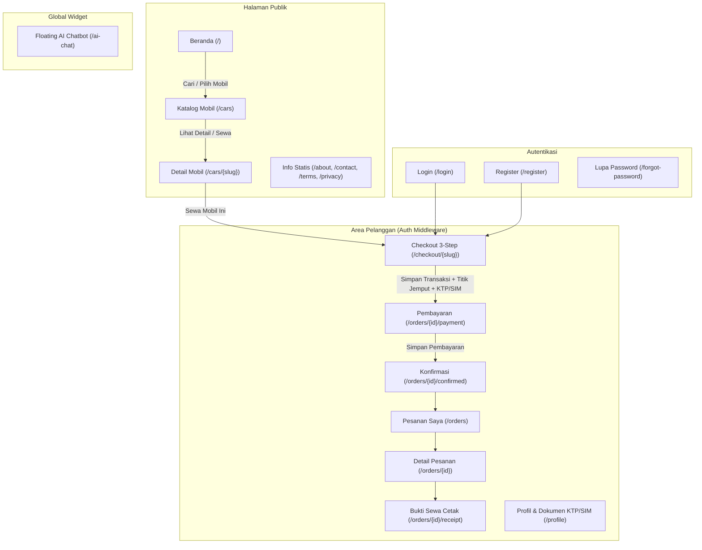
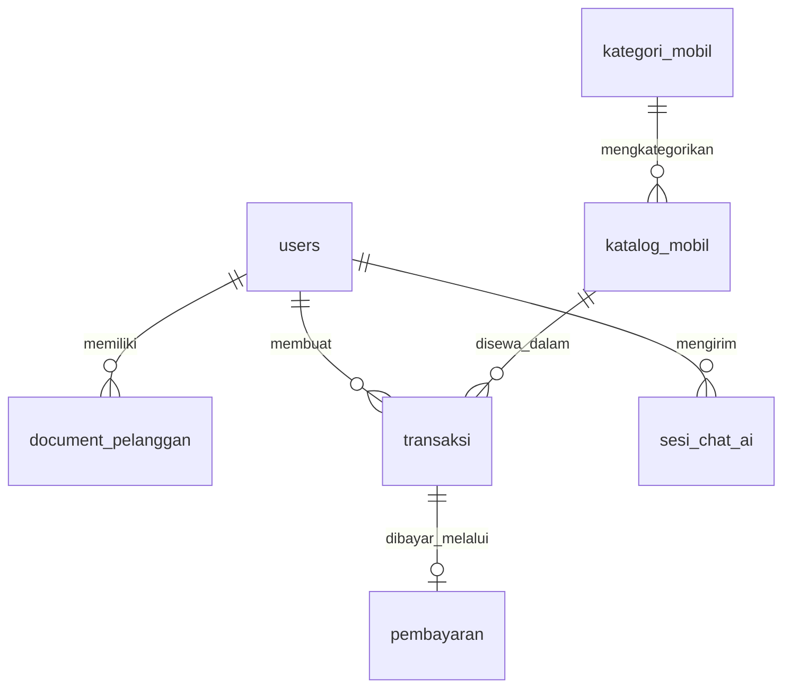

# Implementation Plan: Implementasi Frontend MAZSEH (Public & Customer Scope)

Dokumen ini merinci rencana implementasi desain referensi [index.html](file:///d:/laragon/www/mazseh/web_front_maszeh/index.html) beserta sistem desain **"Modern Tech-Luxury Fleet"** ([DESIGN.md](file:///d:/laragon/www/mazseh/web_front_maszeh/DESIGN.md) & [DESIGN-HANDOFF.md](file:///d:/laragon/www/mazseh/web_front_maszeh/DESIGN-HANDOFF.md)) ke dalam arsitektur **Multi-Page Laravel 13 Blade Views & Komponen** yang terhubung langsung ke database.

---

## 1. Ringkasan Keputusan Arsitektur

Berdasarkan diskusi sebelumnya, implementasi Tahap 1 ini mengikuti empat pilar utama:

1. **Arsitektur Multi-Page Laravel Blade & Komponen:** Memecah prototipe SPA di [app.js](file:///d:/laragon/www/mazseh/web_front_maszeh/app.js) menjadi halaman-halaman Blade terstruktur (`resources/views/layouts/`, `resources/views/components/`, `resources/views/public/`, `resources/views/customer/`, `resources/views/auth/`) dengan routing standar Laravel di [web.php](file:///d:/laragon/www/mazseh/routes/web.php).
2. **Integrasi Penuh dengan Database & Seeder:** Seluruh katalog kendaraan, kategori, pengguna, dokumen pelanggan, transaksi, pembayaran, dan sesi chat AI diambil serta disimpan langsung ke tabel database menggunakan Eloquent Models.
3. **Fokus Halaman Public & Pelanggan (Tahap 1):** Mencakup *Home*, *Katalog & Filter*, *Detail Mobil*, *Login/Register/Lupa Password*, *Checkout 3 Langkah*, *Pesanan Saya*, *Detail Pesanan*, *Pembayaran*, *Konfirmasi & Bukti Sewa (Print)*, *Profil Pelanggan*, serta halaman informasi (*Tentang Kami*, *Kontak*, *Syarat & Ketentuan*, *Kebijakan Privasi*). *(Halaman Kasir & Admin akan dikerjakan pada tahap berikutnya).*
4. **Penambahan Komponen UI Berbasis Skema Database:**
   - **Floating AI Chatbot Widget** yang terhubung ke tabel `sesi_chat_ai` (`pesan_pelanggan`, `balasan_ai`, `status_sesi`: `diselesaikan_ai` / `dialihkan_ke_wa`).
   - **Upload Dokumen KTP & SIM** yang terhubung ke tabel `document_pelanggan` (`file_ktp`, `file_sim`, `status_verifikasi`) pada halaman Profil dan langkah Checkout.
   - **Input Titik Jemput & Koordinat Lokasi** yang terhubung ke tabel `transaksi` (`titik_jemput`, `latitude`, `longitude`) pada langkah Checkout.

> [!IMPORTANT]
> **Penyesuaian Kolom UI pada Database:**
> Agar tampilan kartu mobil, filter katalog, detail unit, profil, dan riwayat pembayaran di Blade tampil 100% identik dengan prototipe [data.js](file:///d:/laragon/www/mazseh/web_front_maszeh/data.js) tanpa *hardcode*, kita perlu menambahkan migrasi kolom atribut tampilan UI pada tabel `katalog_mobil`, `users`, `transaksi`, dan `pembayaran` (detail lengkap ada pada **Bagian 3.2** di bawah). Semua kolom lama dan relasi utama tetap dipertahankan.

---

## 2. Diagram Alur Halaman & Integrasi Data

---

## 3. Rincian Perubahan yang Diusulkan (Proposed Changes)

### 3.1. Aset Visual & Stylesheet (`public/` & `resources/css/`)

Memindahkan seluruh aset desain dari folder referensi [web_front_maszeh](file:///d:/laragon/www/mazseh/web_front_maszeh) agar dapat diakses oleh Blade:

- **[NEW] `public/assets/`**
  - Menyalin 6 gambar kendaraan (`agya.png`, `alphard.png`, `avanza.png`, `camry.png`, `fortuner.png`, `zenix.png`) dan font `inter-latin.woff2` dari `web_front_maszeh/assets/` ke `public/assets/`.
- **[NEW] `public/css/mazseh.css` (atau diintegrasikan melalui `resources/css/app.css`)**
  - Mengadopsi seluruh *design tokens* dan komponen CSS dari [styles.css](file:///d:/laragon/www/mazseh/web_front_maszeh/styles.css) (`--primary: #0F172A`, `--secondary: #2563EB`, `--cta: #F97316`, `--bg: #F8FAFC`, tipografi `Inter`, *layout*, *hero*, *booking console*, *car card*, *filter sidebar*, *stepper checkout*, *print receipt*).
  - Menambahkan styling khusus dengan estetika senada untuk:
    1. **Floating AI Chatbot Widget** (tombol mengambang di kanan bawah, jendela chat dengan header gelap `#0F172A`, bubble pesan pelanggan & AI, *quick prompts*, serta tombol eskalasi ke WhatsApp).
    2. **Dropzone / Preview Upload KTP & SIM** beserta lencana status verifikasi (`belum_upload`, `menunggu_validasi`, `disetujui`, `ditolak`).
    3. **Panel Titik Jemput & Pemilih Koordinat (`latitude`, `longitude`)** pada Checkout.

---

### 3.2. Migrasi Tambahan, Eloquent Models, & Database Seeder

Saat ini baru model [User.php](file:///d:/laragon/www/mazseh/app/Models/User.php) yang tersedia. Kita akan membuat model Eloquent untuk seluruh tabel dan satu migrasi tambahan agar atribut visual pada prototipe tersimpan di database.

#### Migrasi Tambahan UI Metadata
- **[NEW] `database/migrations/2026_11_04_000001_add_frontend_attributes_to_tables.php`**
  - **Tabel `katalog_mobil`** (menambahkan kolom pendukung UI dari [data.js](file:///d:/laragon/www/mazseh/web_front_maszeh/data.js) ke [2026_10_28_034544_create_katalog_mobil_table.php](file:///d:/laragon/www/mazseh/database/migrations/2026_10_28_034544_create_katalog_mobil_table.php)):
    - `slug` (`string`, unique) — contoh: `avanza`, `zenix`, `fortuner`, `agya`, `alphard`, `camry`.
    - `tahun` (`unsignedSmallInteger`, default `2024`)
    - `transmisi` (`string`, 30, default `'Automatic'`) — `'Automatic'` / `'Manual'`
    - `jumlah_kursi` (`unsignedTinyInteger`, default `7`)
    - `bahan_bakar` (`string`, 30, default `'Bensin'`) — `'Bensin'`, `'Hybrid'`, `'Diesel'`
    - `kota` (`string`, 50, default `'Semarang'`) — `'Semarang'`, `'Yogyakarta'`, `'Solo'`
    - `foto_mobil` (`string`, nullable) — path ke `/assets/fortuner.png`, dll.
    - `label` (`string`, 50, nullable) — contoh: `'Favorit Keluarga'`, `'Hybrid Executive'`, `'Siap Medan Berat'`
    - `deskripsi` (`text`, nullable)
    - `fitur` (`json`, nullable) — array fitur kendaraan (`["AC double blower", "Apple CarPlay", ...]`)
  - **Tabel `users`** (melengkapi [0001_01_01_000000_create_users_table.php](file:///d:/laragon/www/mazseh/database/migrations/0001_01_01_000000_create_users_table.php)):
    - `phone` (`string`, 30, nullable)
    - `city` (`string`, 50, nullable)
    - `address` (`text`, nullable)
    - `sim_number` (`string`, 50, nullable)
  - **Tabel `transaksi`** (melengkapi [2026_10_28_035424_create_transaksi_table.php](file:///d:/laragon/www/mazseh/database/migrations/2026_10_28_035424_create_transaksi_table.php)):
    - `kode_booking` (`string`, 30, unique) — contoh: `'MZS-240901'`
    - `waktu_ambil` (`string`, 10, default `'09:00'`)
    - `metode_pengambilan` (`string`, 50, default `'Ambil di pool MAZSEH'`) — `'Ambil di pool MAZSEH'` atau `'Antar ke lokasi saya'`
    - `opsi_pengemudi` (`string`, 30, default `'Lepas kunci'`) — `'Lepas kunci'` atau `'Dengan sopir'`
    - `catatan` (`text`, nullable)
  - **Tabel `pembayaran`** (melengkapi [2026_10_28_040217_create_pembayaran_table.php](file:///d:/laragon/www/mazseh/database/migrations/2026_10_28_040217_create_pembayaran_table.php)):
    - `metode_pembayaran` (`string`, 50, default `'Transfer bank'`) — `'Transfer bank'`, `'QRIS'`, `'Tunai di kasir'`
    - `referensi_pembayaran` (`string`, 100, nullable)
    - `bukti_bayar` (`string`, 255, nullable)

#### Eloquent Models (`app/Models/`)
- **[MODIFY] [User.php](file:///d:/laragon/www/mazseh/app/Models/User.php)**: Menambahkan relasi `dokumenPelanggan()`, `transaksi()`, `sesiChatAi()`, serta atribut `phone`, `city`, `address`, `sim_number` pada `#[Fillable]`.
- **[NEW] `app/Models/KategoriMobil.php`**: Model untuk `kategori_mobil` (`id_kategori`, `nama_kategori`) dengan relasi `mobil()`.
- **[NEW] `app/Models/KatalogMobil.php`**: Model untuk `katalog_mobil` (`id_mobil`, `casts` JSON untuk `fitur`, helper format harga Rupiah & cek ketersediaan tanggal) dengan relasi `kategori()` dan `transaksi()`.
- **[NEW] `app/Models/DocumentPelanggan.php`**: Model untuk `document_pelanggan` (`id_dokumen`, `user_id`, `file_ktp`, `file_sim`, `status_verifikasi`).
- **[NEW] `app/Models/Transaksi.php`**: Model untuk `transaksi` (`id_transaksi`, kalkulasi durasi hari sewa, relasi `user()`, `mobil()`, `pembayaran()`).
- **[NEW] `app/Models/Pembayaran.php`**: Model untuk `pembayaran` (`id_pembayaran`, relasi `transaksi()`, `kasir()`).
- **[NEW] `app/Models/SesiChatAi.php`**: Model untuk `sesi_chat_ai` (`id_sesi`, `user_id`, `pesan_pelanggan`, `balasan_ai`, `status_sesi`, `waktu_sesi`).

#### Seeder Data (`database/seeders/`)
- **[MODIFY] [DatabaseSeeder.php](file:///d:/laragon/www/mazseh/database/seeders/DatabaseSeeder.php)**:
  - Memperbarui seeder agar memuat **4 Kategori Mobil** (`MPV`, `SUV`, `Hatchback`, `Sedan`), **6 Unit Kendaraan** lengkap dari [data.js](file:///d:/laragon/www/mazseh/web_front_maszeh/data.js) (`Toyota All New Avanza`, `Toyota Kijang Innova Zenix`, `Toyota Fortuner GR Sport`, `Toyota Agya GR Sport`, `Toyota Alphard Executive Lounge`, `Toyota Camry Hybrid`) beserta gambar, spesifikasi, fitur, dan harga sewa, **3 Akun Demo** (`pelanggan@mazseh.id` / `raka@contoh.id`, `kasir@mazseh.id`, `admin@mazseh.id`), sampel dokumen pelanggan, serta sampel transaksi & pembayaran awal.

---

### 3.3. Struktur Blade Layouts, Components, & Views (`resources/views/`)

Semua tampilan dipisah secara modular mengikuti pola komponen Blade Laravel:

| Kategori | File Blade | Deskripsi & Sumber Referensi dari `web_front_maszeh` |
| :--- | :--- | :--- |
| **Layout Utama** | `resources/views/layouts/app.blade.php` | Shell dokumen HTML5, font `Inter`, stylesheet, `<x-header />`, `<main>`, `<x-footer />`, `<x-toast />`, dan `<x-ai-chatbot />`. |
| **Komponen Global** | `resources/views/components/header.blade.php` | Header sticky dengan brand mark `MAZSEH`, navigasi aktif (`Beranda`, `Sewa Mobil`, `Tentang Kami`, `Kontak`, `Akun Saya` / `Pesanan Saya`), dan aksi Masuk/Daftar/Profil. |
| **Komponen Global** | `resources/views/components/footer.blade.php` | Footer 4 kolom (Brand info, Navigasi, Layanan & Kebijakan, Kontak & Jam Operasional). |
| **Komponen Global** | `resources/views/components/car-card.blade.php` | Kartu kendaraan reusable (badge status ketersediaan, tag/label, gambar unit, tombol favorit, spesifikasi kursi/transmisi/BBM, harga per hari, tombol *Detail* & *Sewa*). |
| **Komponen Global** | `resources/views/components/booking-summary.blade.php` | Panel ringkasan sewa sticky di sisi kanan halaman Checkout, Pembayaran, dan Detail Pesanan. |
| **Komponen Baru** | `resources/views/components/ai-chatbot.blade.php` | **Floating AI Assistant MAZSEH**: menampilkan riwayat `sesi_chat_ai`, menjawab pertanyaan seputar ketersediaan armada/syarat sewa/harga, dan tombol *"Hubungi Admin via WhatsApp"* (`dialihkan_ke_wa`). |
| **Public Views** | `resources/views/public/home.blade.php` | Hero gelap dengan Fortuner visual, **Floating Booking Console** (lokasi, kategori, tanggal ambil & kembali), 3 poin keunggulan, chip filter kategori + grid unit populer, 3 langkah cara pemesanan, dan CTA banner. |
| **Public Views** | `resources/views/public/catalog/index.blade.php` | Halaman katalog dengan **Sticky Filter Sidebar** (pencarian nama, kota, kategori, tanggal sewa, transmisi, batas harga maksimal, filter favorit) + pengurutan (`Pilihan MAZSEH`, `Harga terendah`, `Harga tertinggi`) + grid hasil filter. |
| **Public Views** | `resources/views/public/catalog/show.blade.php` | Halaman detail mobil: breadcrumb, gambar utama, 4 kotak spesifikasi, deskripsi & daftar fitur, info persiapan unit, serta **Sticky Booking Panel** dengan kalkulator estimasi durasi & cek bentrok jadwal otomatis. |
| **Public Views** | `resources/views/public/pages/about.blade.php` `resources/views/public/pages/contact.blade.php` `resources/views/public/pages/terms.blade.php` `resources/views/public/pages/privacy.blade.php` | Halaman informasi statis (*Tentang Kami*, *Kontak & Form Pesan*, *Syarat & Ketentuan*, *Kebijakan Privasi*) sesuai desain referensi. |
| **Auth Views** | `resources/views/auth/login.blade.php` `resources/views/auth/register.blade.php` `resources/views/auth/forgot-password.blade.php` | Split layout dengan *Auth Story Panel* gelap (visual Innova Zenix) di kiri dan form autentikasi di kanan, dilengkapi tombol pengisi cepat akun demo (*Pelanggan*, *Kasir*, *Admin*). |
| **Customer Views** | `resources/views/customer/checkout/create.blade.php` | **Stepper 3 Langkah:** 1. **Jadwal & Lokasi Jemput:** Tanggal mulai/selesai, jam ambil, opsi sopir, metode ambil (Pool / Antar ke lokasi), serta input **`titik_jemput` + koordinat `latitude` & `longitude`** (dilengkapi tombol *"Gunakan Lokasi Saya / Pilih Titik Koordinat"*). 2. **Data Penyewa & Dokumen (`document_pelanggan`):** Nama, telepon, nomor SIM, dan **Upload/Preview File KTP & SIM** (`file_ktp`, `file_sim`). 3. **Konfirmasi Pesanan:** Rincian biaya transparan dan persetujuan syarat sewa. |
| **Customer Views** | `resources/views/customer/orders/payment.blade.php` | Halaman instruksi & konfirmasi pembayaran (`Transfer bank`, `QRIS`, `Tunai di kasir`), input referensi/bukti pembayaran, terhubung ke tabel `pembayaran`. |
| **Customer Views** | `resources/views/customer/orders/confirmed.blade.php` | Halaman konfirmasi sukses setelah pesanan/pembayaran dikirim, dengan tautan ke Detail Pesanan & Cetak Bukti Sewa. |
| **Customer Views** | `resources/views/customer/orders/index.blade.php` | Daftar pesanan pelanggan dengan chip filter status (`Semua`, `Menunggu Pembayaran`, `Dikonfirmasi`, `Dibatalkan`). |
| **Customer Views** | `resources/views/customer/orders/show.blade.php` | Detail pesanan lengkap: status pesanan & pembayaran, lokasi titik jemput & koordinat, timeline progres, serta modal pembatalan pesanan (`alasan_batal`). |
| **Customer Views** | `resources/views/customer/orders/receipt.blade.php` | Bukti sewa / invoice resmi dengan dukungan cetak langsung (`window.print()` & `@media print`). |
| **Customer Views** | `resources/views/customer/profile/edit.blade.php` | Halaman profil pelanggan: form biodata, status verifikasi dokumen (`belum_upload`, `menunggu_validasi`, `disetujui`, `ditolak`), serta form unggah/perbarui foto KTP & SIM. |

---

### 3.4. Controllers & Routing (`app/Http/Controllers/` & `routes/web.php`)

Seluruh controller akan mengikuti standar PHP 8.5 di [AGENTS.md](file:///d:/laragon/www/mazseh/AGENTS.md) (*explicit return types*, *constructor property promotion*, *Form Request validation*).

- **[NEW] `app/Http/Controllers/HomeController.php`**
  - `index()`: Menampilkan beranda dengan daftar kategori dan 6 unit kendaraan unggulan.
- **[NEW] `app/Http/Controllers/CatalogController.php`**
  - `index(Request $request)`: Menangani filter query, kota, kategori, transmisi, harga maksimal, rentang tanggal ketersediaan, dan pengurutan.
  - `show(string $slug, Request $request)`: Menampilkan detail mobil, mengecek ketersediaan unit pada rentang tanggal yang dipilih (`transaksi` aktif yang beririsan), dan menghitung estimasi biaya.
- **[NEW] `app/Http/Controllers/AuthController.php`**
  - `showLogin()`, `login()`, `showRegister()`, `register()`, `showForgotPassword()`, `sendResetLink()`, `logout()`.
- **[NEW] `app/Http/Controllers/CheckoutController.php`**
  - `create(string $slug, Request $request)`: Menampilkan halaman Checkout 3 langkah beserta data pengguna & status `document_pelanggan`.
  - `store(StoreCheckoutRequest $request, string $slug)`: Memvalidasi jadwal, menyimpan/memperbarui file KTP & SIM ke `document_pelanggan` (`storage/app/public/documents/`), membuat record `transaksi` (termasuk `titik_jemput`, `latitude`, `longitude`), dan membuat record awal `pembayaran` (`status_pembayaran = 'pending'`).
- **[NEW] `app/Http/Controllers/OrderController.php`**
  - `index(Request $request)`: Menampilkan daftar transaksi milik pelanggan yang sedang login dengan filter status.
  - `show(Transaksi $transaksi)`: Menampilkan detail transaksi & pembayaran.
  - `payment(Transaksi $transaksi)` & `submitPayment(Request $request, Transaksi $transaksi)`: Menyimpan konfirmasi metode/referensi pembayaran ke tabel `pembayaran`.
  - `confirmed(Transaksi $transaksi)`: Menampilkan halaman sukses pemesanan.
  - `receipt(Transaksi $transaksi)`: Menampilkan halaman cetak bukti sewa.
  - `cancel(Request $request, Transaksi $transaksi)`: Membatalkan pesanan yang masih `menunggu_pembayaran` dan menyimpan `alasan_batal`.
- **[NEW] `app/Http/Controllers/ProfileController.php`**
  - `edit()`: Menampilkan profil pelanggan, ringkasan jumlah pesanan, dan status `document_pelanggan`.
  - `update(UpdateProfileRequest $request)`: Memperbarui data profil serta unggahan file KTP & SIM (`file_ktp`, `file_sim`, mengubah `status_verifikasi` menjadi `menunggu_validasi`).
- **[NEW] `app/Http/Controllers/AiChatController.php`**
  - `sendMessage(Request $request)`: Menerima pertanyaan pelanggan via AJAX/fetch, mencari jawaban kontekstual dari data armada `katalog_mobil` & kebijakan sewa MAZSEH (atau mengalihkan ke WhatsApp jika diminta/di luar cakupan), lalu menyimpan riwayatnya ke tabel `sesi_chat_ai`.
- **[NEW] `app/Http/Controllers/PageController.php`**
  - `about()`, `contact()`, `submitContact(Request $request)`, `terms()`, `privacy()`.

---

## 4. Rencana Pengujian & Verifikasi (Verification Plan)

1. **Migrasi & Seeder Verification:**
   - Menjalankan `php artisan migrate:fresh --seed` untuk memastikan seluruh tabel, relasi *foreign key*, dan 6 unit mobil dari referensi berhasil masuk ke database tanpa error.
2. **Automated Feature Tests (`tests/Feature/`):**
   - `PublicPagesTest`: Memastikan halaman Beranda, Katalog (beserta parameter filter), Detail Mobil, Tentang Kami, Kontak, Syarat & Ketentuan, dan Privasi merender status HTTP `200` dengan data dari database.
   - `AuthFlowTest`: Menguji proses Login, Register, dan Logout pelanggan.
   - `CheckoutAndOrderFlowTest`: Menguji alur lengkap pemilihan mobil -> Checkout (dengan input `titik_jemput`, `latitude`, `longitude`, serta upload file KTP & SIM ke `document_pelanggan`) -> Pembayaran (`pembayaran`) -> Detail Pesanan -> Cetak Bukti Sewa -> Pembatalan Pesanan (`alasan_batal`).
   - `AiChatTest`: Menguji endpoint chatbot menyimpan pesan pelanggan & balasan AI ke tabel `sesi_chat_ai` serta mendukung status `dialihkan_ke_wa`.
3. **Visual & Responsive Check:**
   - Memastikan kesesuaian tata letak dengan kontrak desain di [DESIGN-HANDOFF.md](file:///d:/laragon/www/mazseh/web_front_maszeh/DESIGN-HANDOFF.md) (Tipografi `Inter`, warna `#0F172A` / `#2563EB` / `#F97316`, *Floating Booking Console*, kartu armada, dan *print view* bukti sewa).
